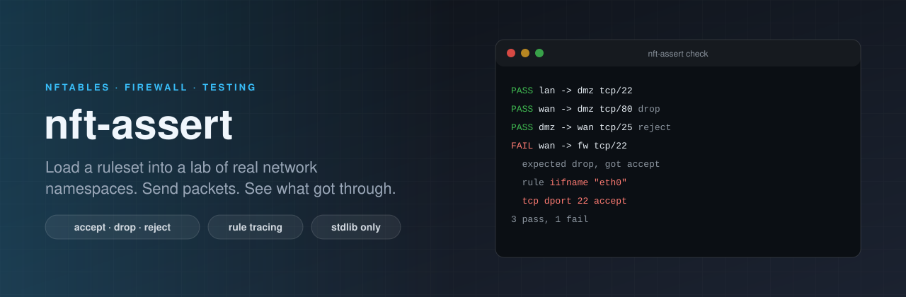

<p align="center"></p>

# nft-assert

[](https://github.com/ErenOzgu/nft-assert/actions/workflows/ci.yml)


**Test an nftables ruleset with real packets.** nft-assert builds a small lab out of Linux network namespaces, loads
your ruleset into the one that plays the firewall, sends real TCP, UDP and ping from the others, and compares what
happened with what you wrote down in a short TOML file. When a flow does something you did not expect, it sends it
once more with nftables' own packet tracing and tells you which rule, or which chain policy, decided it.

Python standard library only. It needs Linux, root, `ip` and `nft`. It never touches the host's own network
interfaces or ruleset: everything happens in namespaces it creates and removes again.

## Why

`nft -c -f ruleset.nft` tells you the file is valid. It does not tell you whether the lan can still reach the dmz on
443, whether the internet reaches anything but the port forward, or whether the mail server is refused (the sender
notices) or silently ignored (the sender waits). Those questions are usually answered by reloading the firewall and
hoping. nft-assert answers them in a second or two, in CI, and shows you what a change opened or closed.

## Try it

```sh
pip install git+https://github.com/ErenOzgu/nft-assert        # or: git clone, then pip install .
sudo nft-assert check examples/edge/spec.toml
```

The example is an edge firewall with three zones, a port forward and a masquerade. This is its spec:

<!-- include:examples/edge/spec.toml -->
```toml
# What the edge firewall must and must not let through.
[ruleset]
file = "firewall.nft"

[zones.wan]
subnet = "192.0.2.0/24"
iface = "eth0"

[zones.lan]
subnet = "10.0.1.0/24"
iface = "eth1"

[zones.dmz]
subnet = "10.0.2.0/24"
iface = "eth2"

[expect.accept]
"lan -> wan" = ["tcp/80", "tcp/443", "udp/53", "icmp"]
"lan -> dmz" = ["tcp/22", "tcp/80", "tcp/443", "icmp"]
"lan -> fw" = ["tcp/22", "icmp"]
"dmz -> wan" = ["tcp/80", "tcp/443"]
"wan -> fw" = ["icmp"]
"wan -> 192.0.2.1" = ["tcp/8080"]          # the port forward

[expect.drop]
"wan -> lan" = ["tcp/22", "tcp/80", "icmp"]
"wan -> dmz" = ["tcp/22", "tcp/80"]        # the web server is not reachable directly
"wan -> fw" = ["tcp/22", "tcp/80"]
"dmz -> lan" = ["tcp/22", "tcp/80", "icmp"]
"dmz -> fw" = ["tcp/22"]
"lan -> fw" = ["tcp/80"]

[expect.reject]
"dmz -> wan" = ["tcp/25"]                  # a refusal the sender notices, not silence

# Who answered the port forward, on which port, and what address the web server saw. The masquerade
# should show the internet host the firewall's address, not the lan's.
[[observe]]
flow = "wan -> 192.0.2.1 tcp/8080"
reached = "dmz"
reached_port = 80
source_seen = "192.0.2.2"

[[observe]]
flow = "lan -> wan tcp/80"
source_seen = "192.0.2.1"

[matrix]
tcp = [22, 25, 80, 443, 8080]
udp = [53]
icmp = true
```
<!-- /include -->

A zone is a subnet with one host in it, on the other end of one interface of the firewall. `fw` is the firewall
itself. The expectations are a flow (`"from -> to"`) and a list of probes (`tcp/22`, `udp/53`, `icmp`). The ruleset it
checks is [`examples/edge/firewall.nft`](examples/edge/firewall.nft), and everything passes:

<details>
<summary>The output of <code>nft-assert check</code> on the good ruleset</summary>

<!-- include:examples/edge/check.txt -->
```text
nft-assert  spec.toml
ruleset     firewall.nft
lab         firewall + 3 zones (wan, lan, dmz); 27 flows checked first with no ruleset: all got through

  PASS  lan -> wan tcp/80          accept
          answered by wan on port 80, which saw the source 192.0.2.1
  PASS  lan -> wan tcp/443         accept
  PASS  lan -> wan udp/53          accept
  PASS  lan -> wan icmp            accept
  PASS  lan -> dmz tcp/22          accept
  PASS  lan -> dmz tcp/80          accept
  PASS  lan -> dmz tcp/443         accept
  PASS  lan -> dmz icmp            accept
  PASS  lan -> fw tcp/22           accept
  PASS  lan -> fw icmp             accept
  PASS  dmz -> wan tcp/80          accept
  PASS  dmz -> wan tcp/443         accept
  PASS  wan -> fw icmp             accept
  PASS  wan -> 192.0.2.1 tcp/8080  accept
          answered by dmz on port 80, which saw the source 192.0.2.2
  PASS  wan -> lan tcp/22          drop
  PASS  wan -> lan tcp/80          drop
  PASS  wan -> lan icmp            drop
  PASS  wan -> dmz tcp/22          drop
  PASS  wan -> dmz tcp/80          drop
  PASS  wan -> fw tcp/22           drop
  PASS  wan -> fw tcp/80           drop
  PASS  dmz -> lan tcp/22          drop
  PASS  dmz -> lan tcp/80          drop
  PASS  dmz -> lan icmp            drop
  PASS  dmz -> fw tcp/22           drop
  PASS  lan -> fw tcp/80           drop
  PASS  dmz -> wan tcp/25          reject

27 expectations, 27 pass, 0 fail
```
<!-- /include -->

</details>

Three things in that output are worth a second look. `wan -> 192.0.2.1 tcp/8080` was answered by the dmz on port 80,
so the port forward does what it says. The web server saw the source `192.0.2.2`, the internet host, as it should.
And `lan -> wan tcp/80` reached a wan host that saw `192.0.2.1`, the firewall's own address: the masquerade works.

## When something is wrong

Now the same spec against a ruleset with two mistakes. In one, the ssh rule says `iifname "eth0"` where it meant
`eth1`, so the lan loses ssh to the firewall and the internet gains it. In the other, someone dropped the
`ct status dnat` condition from the dmz rule, so the web server is reachable directly, not only through the port
forward. [`examples/edge/firewall-broken.nft`](examples/edge/firewall-broken.nft) differs from the good one in exactly
those two lines.

<!-- include:examples/edge/check-broken.txt -->
```text
nft-assert  spec.toml
ruleset     firewall-broken.nft
lab         firewall + 3 zones (wan, lan, dmz); 27 flows checked first with no ruleset: all got through

  PASS  lan -> wan tcp/80          accept
          answered by wan on port 80, which saw the source 192.0.2.1
  PASS  lan -> wan tcp/443         accept
  PASS  lan -> wan udp/53          accept
  PASS  lan -> wan icmp            accept
  PASS  lan -> dmz tcp/22          accept
  PASS  lan -> dmz tcp/80          accept
  PASS  lan -> dmz tcp/443         accept
  PASS  lan -> dmz icmp            accept
  FAIL  lan -> fw tcp/22           accept
          expected accept, got drop (no answer to the SYN in 1 s)
          what the firewall did with the first packet:
            ip nat prerouting: no rule matched, the chain policy is accept
            inet filter input: no rule matched, the chain policy is drop
  PASS  lan -> fw icmp             accept
  PASS  dmz -> wan tcp/80          accept
  PASS  dmz -> wan tcp/443         accept
  PASS  wan -> fw icmp             accept
  PASS  wan -> 192.0.2.1 tcp/8080  accept
          answered by dmz on port 80, which saw the source 192.0.2.2
  PASS  wan -> lan tcp/22          drop
  PASS  wan -> lan tcp/80          drop
  PASS  wan -> lan icmp            drop
  PASS  wan -> dmz tcp/22          drop
  FAIL  wan -> dmz tcp/80          drop
          expected drop, got accept (connection established)
          what the firewall did with the first packet:
            ip nat prerouting: no rule matched, the chain policy is accept
            inet filter forward: rule `iifname "eth0" oifname "eth2" tcp dport 80 accept comment "internet to the web server"` -> accept
            ip nat postrouting: no rule matched, the chain policy is accept
  FAIL  wan -> fw tcp/22           drop
          expected drop, got accept (connection established)
          what the firewall did with the first packet:
            ip nat prerouting: no rule matched, the chain policy is accept
            inet filter input: rule `iifname "eth0" tcp dport 22 accept comment "ssh to the firewall, from the lan only"` -> accept
  PASS  wan -> fw tcp/80           drop
  PASS  dmz -> lan tcp/22          drop
  PASS  dmz -> lan tcp/80          drop
  PASS  dmz -> lan icmp            drop
  PASS  dmz -> fw tcp/22           drop
  PASS  lan -> fw tcp/80           drop
  PASS  dmz -> wan tcp/25          reject

27 expectations, 24 pass, 3 fail
```
<!-- /include -->

The exit code is 1, and each failure names the rule that decided the packet, or the chain policy when no rule
matched. The first failure (`lan -> fw tcp/22`) is the typo seen from the lan: no rule matches, so the input policy
drops it. The third is the same typo seen from the internet.

The trace is only an explanation. Whether a flow counts as accepted, rejected or dropped is decided by the packets
that actually arrived or did not, never by the trace.

## Who can reach whom

`nft-assert matrix` sends every kind of traffic from every place to every other place and prints a table. Commit it,
and `nft-assert matrix SPEC --check matrix.md` fails when a change to the ruleset alters any cell:

<!-- include:examples/edge/matrix.md -->
| From | To | tcp/22 | tcp/25 | tcp/80 | tcp/443 | tcp/8080 | udp/53 | icmp |
|---|---|---|---|---|---|---|---|---|
| fw | wan | accept | accept | accept | accept | accept | accept | accept |
| fw | lan | accept | accept | accept | accept | accept | accept | accept |
| fw | dmz | accept | accept | accept | accept | accept | accept | accept |
| wan | fw | drop | drop | drop | drop | accept | drop | accept |
| wan | lan | drop | drop | drop | drop | accept | drop | drop |
| wan | dmz | drop | drop | drop | drop | accept | drop | drop |
| lan | fw | accept | drop | drop | drop | drop | drop | accept |
| lan | wan | accept | accept | accept | accept | accept | accept | accept |
| lan | dmz | accept | drop | accept | accept | drop | drop | accept |
| dmz | fw | drop | drop | drop | drop | drop | drop | accept |
| dmz | wan | drop | reject | accept | accept | drop | drop | drop |
| dmz | lan | drop | drop | drop | drop | drop | drop | drop |
<!-- /include -->

The matrix shows things a hand-written spec does not think to ask. Look at the `tcp/8080` column: `wan -> lan` and
`wan -> dmz` say `accept`, not only `wan -> fw`. The port forward rule matches any destination address on port 8080
arriving on `eth0`, so a connection to the lan host on that port is also sent to the web server. That may be fine. It
is worth knowing.

## What did this change open?

`nft-assert diff SPEC OLD NEW` loads two rulesets one after the other into the same lab, sends the same flows, and
lists the flows whose outcome changed. Exit code 1 means something changed, so it also works as a gate. For the two
edge rulesets above:

<!-- include:examples/edge/diff.txt -->
```text
lan -> fw tcp/22: accept -> drop
wan -> dmz tcp/80: drop -> accept
wan -> fw tcp/22: drop -> accept

3 of 84 flows changed
```
<!-- /include -->

## A real case: the firewall role of ubuntu-hardening-roles

My [ubuntu-hardening-roles](https://github.com/ErenOzgu/ubuntu-hardening-roles) repository has an Ansible role that
installs a small input-only host firewall (`hardening.nft.j2`). Rendering that template with its default variables
plus `firewall_tcp_ports: [443]` gives [`examples/hardening/host.nft`](examples/hardening/host.nft), and this spec
says what the host must answer:

<!-- include:examples/hardening/spec.toml -->
```toml
# The host firewall that the ubuntu-hardening-roles `firewall` role installs (rendered once with its default
# variables plus firewall_tcp_ports: [443], see host.nft). It only has an input chain, so every flow here is
# "something on the network -> this host".
[ruleset]
file = "host.nft"

[zones.net]
subnet = "198.51.100.0/24"

[expect.accept]
"net -> fw" = ["tcp/22", "tcp/443", "icmp"]

[expect.drop]
"net -> fw" = ["tcp/21", "tcp/23", "tcp/80", "tcp/3306", "tcp/5432", "udp/53", "udp/123"]

[matrix]
tcp = [22, 80, 443, 3306]
udp = [53]
icmp = true
```
<!-- /include -->

It passes. Then someone adds `3306` to `firewall_tcp_ports` to let a colleague test something. Rendering the template
again gives `host-with-mysql.nft`, and `nft-assert diff` shows what that opens to the whole network:

<!-- include:examples/hardening/diff.txt -->
```text
net -> fw tcp/3306: drop -> accept

1 of 12 flows changed
```
<!-- /include -->

## Spec reference

Unknown keys are errors, because a typo in `[expect.drop]` that is silently ignored would turn a test into a pass.
Paths are relative to the spec file.

| Key | Where | Meaning |
|---|---|---|
| `file` | `[ruleset]` | The ruleset to load. It is read with `nft -f`, so `include` and `define` work, and `include` finds files next to it. |
| `subnet` | `[zones.NAME]` | Required. An IPv4 network from /8 to /29. Zones must not overlap. |
| `iface` | `[zones.NAME]` | The firewall's interface towards this zone, the name your ruleset uses in `iifname` and `oifname`. Defaults to the zone name. |
| `fw_address` | `[zones.NAME]` | The firewall's address in the zone. Defaults to the first host address. |
| `host_address` | `[zones.NAME]` | The zone's host. Defaults to the second host address. |
| `flow` | `[[observe]]` | A flow such as `"wan -> 192.0.2.1 tcp/8080"`. It must also be listed under `[expect.accept]`. |
| `reached` | `[[observe]]` | Which place must answer: `fw` or a zone name. |
| `reached_port` | `[[observe]]` | The port the answering host was reached on, after any port forward. |
| `source_seen` | `[[observe]]` | The source address the answering host saw, after any NAT. |
| `tcp` | `[matrix]` | The TCP ports the matrix sends to. Default `[22, 80, 443]`. |
| `udp` | `[matrix]` | The UDP ports. Default `[53]`. |
| `icmp` | `[matrix]` | Whether to ping. Default `true`. |
| `timeout` | top level | Seconds to wait for an answer before a flow counts as dropped. 0.2 to 30, default 1. |

`[expect.accept]`, `[expect.drop]` and `[expect.reject]` hold `"from -> to" = [probes]`. A place is a zone name, `fw`,
or (as a destination) an IPv4 address, which is how a port forward on the firewall's own address is tested. A probe is
`tcp/PORT`, `udp/PORT` or `icmp`. The three verdicts mean:

* **accept**: a TCP handshake completed, a UDP datagram was answered, or a ping came back.
* **reject**: the sender was told no: a TCP reset or any ICMP destination unreachable.
* **drop**: nothing came back within the timeout.

Every zone host, and the firewall, listens on every probed port, so a refusal can only come from the ruleset, never
from a port nobody listens on.

## Commands

<!-- options:start -->
| Command | Argument or option | What it does |
|---|---|---|
| `check` | `SPEC` | the spec file (TOML) |
| `check` | `--timeout SECONDS` | how long a silent flow is waited for before it counts as dropped (default: the spec's, else 1) |
| `check` | `--ruleset FILE` | load this ruleset instead of the one named in the spec |
| `check` | `-f, --format {text,md,json}` | how to print the result (default text) |
| `check` | `--junit FILE` | also write a JUnit XML report |
| `check` | `--github-summary` | append a Markdown report to $GITHUB_STEP_SUMMARY |
| `check` | `--no-explain` | do not re-send failed flows with tracing to find the deciding rule |
| `check` | `--no-sanity` | skip the first pass that sends every flow with no ruleset loaded |
| `matrix` | `SPEC` | the spec file (TOML) |
| `matrix` | `--timeout SECONDS` | how long a silent flow is waited for before it counts as dropped (default: the spec's, else 1) |
| `matrix` | `--ruleset FILE` | load this ruleset instead of the one named in the spec |
| `matrix` | `-f, --format {md,json}` | how to print the matrix (default md) |
| `matrix` | `-o, --output FILE` | write the matrix to this file instead of printing it |
| `matrix` | `--check FILE` | compare with a committed matrix and exit 1 with the differences if it changed |
| `diff` | `SPEC` | the spec file (TOML) |
| `diff` | `--timeout SECONDS` | how long a silent flow is waited for before it counts as dropped (default: the spec's, else 1) |
| `diff` | `OLD` | the ruleset before |
| `diff` | `NEW` | the ruleset after |
| `diff` | `-f, --format {text,md,json}` | how to print the changes (default text) |
<!-- options:end -->

`nft-assert cleanup` deletes network namespaces whose names start with `nfta` and which a killed run left behind. A
normal run, a failing run, Ctrl-C and SIGTERM all remove their lab themselves.

| Exit code | Meaning |
|---|---|
| 0 | Everything is as expected (or the diff is empty, or the matrix is unchanged). |
| 1 | An expectation failed, the matrix differs from the committed one, or the diff found changes. |
| 2 | The spec or the ruleset is wrong. For a ruleset that is nft's own message, with the file name. |
| 3 | The lab could not run: not root, `ip` or `nft` missing, a kernel setting refused, or the sanity pass found the lab itself broken. |
| 130 | Interrupted. The lab was removed. |

## In CI

On a GitHub Actions runner:

```yaml
- run: sudo apt-get install -y nftables
- run: pip install git+https://github.com/ErenOzgu/nft-assert
- run: sudo -E "$(which nft-assert)" check firewall/spec.toml --junit nft-assert.xml --github-summary
- run: sudo -E "$(which nft-assert)" matrix firewall/spec.toml --check firewall/matrix.md
```

The check lands in the job summary as a table, the JUnit file can go to any test reporter, and the matrix step fails
with a diff when somebody changes who can reach whom without updating the committed table.

## How it works

```
zone host  eth0 ---- <iface> [ firewall: your ruleset is loaded here ] <iface> ---- eth0  zone host
```

* One network namespace for the firewall, one per zone, joined by veth pairs. Addresses and default routes are set
  so that traffic between zones is forwarded by the firewall, which has `ip_forward` on.
* A helper process in every namespace listens on every probed TCP and UDP port and answers with a line saying who it
  is, who it thinks is calling and which address it was reached on. That is how `[[observe]]` sees through NAT.
* A second helper sends the probes in parallel (up to 200 at a time per place), so a hundred silent flows cost one
  timeout and not a hundred. TCP is a real `connect()`, UDP a datagram on a connected socket (with `IP_RECVERR`, because without
  it Linux hides ICMP host-unreachable errors from UDP sockets), ping a raw ICMP echo whose reply or error is matched
  on its identifier.
* **Before** your ruleset is loaded, every flow to an address in the lab is sent once. All of them must get through,
  or the run stops with "the lab is broken, not your ruleset". A lab that cannot be trusted is never allowed to
  produce a verdict about your firewall.
* The ruleset is loaded with `nft -c` first, then for real. A syntax error is exit 2 with nft's message.
* The kernel's own limits on ICMP errors (a per-peer one, and a global one that allows 50 in a burst) are raised in
  the namespaces. Otherwise the 51st simultaneous reject would look like a drop. If the kernel still holds an error
  back, the run stops with exit 3 rather than guess.
* For a failed expectation only, a helper table switches `meta nftrace` on for exactly that traffic, the flow is sent
  again, and `nft monitor trace` is read. The helper table is deleted afterwards.

## How it is tested

* **Unit tests, no root needed:** the spec parser (every error message, plus mutated specs, which must either parse or
  say why), the trace parser (against output recorded from a real `nft monitor trace`, including lines the monitor
  cut off), the report formats, the CLI's exit codes and file handling, the worker programs against a real listener on
  loopback, and scans of the source for shell strings, dynamic code and non-standard imports.
* **Live tests, in real namespaces on the real kernel:** accept, drop and nine rejecting rules (a TCP reset and four
  ICMP unreachable codes, on TCP, UDP and ping); input and output chains; NAT seen from the other side; jumps, sets,
  `include`; failing expectations named by the rule that decided them; the matrix and the diff; a hundred
  simultaneous rejects; the kernel holding an error back; two runs at once; Ctrl-C and SIGTERM leaving nothing
  behind; `cleanup`; and a property test that turns a random truth table into a ruleset and requires the matrix to
  measure exactly the table.
* **Committed outputs are regenerated:** the README's output, matrices and diffs are produced by running the tool for
  real in CI (`examples/generate.sh --check`) and must equal the committed files.
* **CI machines:** Ubuntu 22.04 and 24.04 on x86_64 and 24.04 on arm64, Python 3.11, 3.12 and 3.13, as root and, for
  the tests that need no lab, as an ordinary user. A separate job installs the built wheel into a clean virtualenv and
  runs the examples from there, the way the CI snippet above does.
* A one-off mutation check, run by hand and not in CI, made 45 hand-picked single-line changes to lines that decide a
  verdict or guard the lab (the reject errno list, the sanity pass, the trace filter, the cleanup prefix, and so on)
  and ran the whole suite after each: the tests failed for all 45. The list is not exhaustive and it is not
  repeated in CI, so it says what was checked once, not what is guaranteed.

## What it cannot do

* **IPv4 only.** IPv6 is switched off inside the lab, where the kernel allows it.
* One host per zone, and three kinds of traffic: TCP connect, UDP datagram, ICMP echo. No other ICMP types, no
  fragments, no connection tracking helpers (FTP and friends), no throughput or performance.
* **Stateful and rate-limited rules are order-sensitive.** A rule such as `limit rate 5/second` or a meter is
  consumed by the probes in the order they happen to run, so a flow can be accepted or dropped depending on how many
  others went first. The flows are sent in parallel, so that order is not fixed. Use them sparingly in a spec, or put
  one flow per budget.
* The verdicts are the verdicts of **the kernel it runs on**. The same ruleset on a different kernel version, with
  other modules loaded or with a flowtable offloading to hardware, can behave differently.
* The lab's firewall is a router, so chains on the input, forward, output, prerouting and postrouting hooks of the
  `inet` and `ip` families are exercised. Bridge-family rules need a bridge, which the lab does not have, and netdev
  (ingress) rules are untested.
* Needs root, because it creates namespaces. On CI that is `sudo`. Do not run it in a container without
  `CAP_NET_ADMIN` and `CAP_SYS_ADMIN`; it will say what failed.
* It tests a ruleset, not a deployment. It cannot know that the file you test is the file on the machine, or that the
  interface called `eth1` in the spec is the one called `eth1` there.

## License

MIT.
